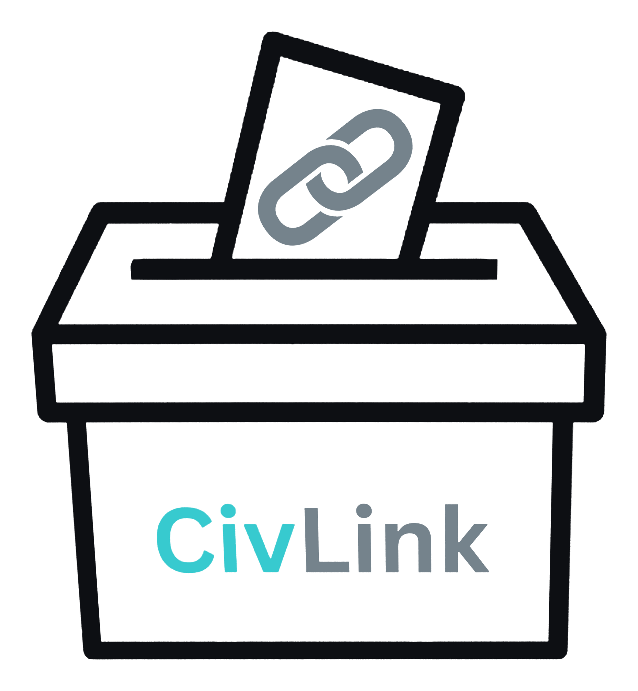

# CivLink — find the office that can actually act

A working prototype that helps a Northern Virginia resident figure out which office of government
handles their concern, write a clear message, and follow updates from their area. It also includes an
**Official Portal** prototype that shows the office side: neutral polls, announcements, aggregate
results, and resident questions.

Built for the **2026 Congressional App Challenge** — Virginia's 10th District.

<br clear="left" />

---

## What it does

Most people send a concern to an office that cannot act on it, and never hear back. CivLink fixes the
routing first:

1. **Pick the issue.** 13 topics, from potholes and school buses to data centers and online privacy.
2. **See who handles it.** CivLink names the office with the authority to act, explains why, lists
   what that office can do, and says plainly what it *cannot* do.
3. **Write the message.** A labeled starting template, a length guide, and warnings for unfilled
   `[brackets]`, all-caps text, and links.
4. **Preview and save.** The message is saved on the device with a reference number, and the app
   opens the office's official website so the resident sends it themselves.

The resident side also has an **updates feed** for the selected locality. Seeded sample
announcements and polls appear there, residents can answer a poll once, ask a question, report
content, and control what appears in the feed.

The **Official Portal** is a separate, clearly labeled demo:

- sign in as a sample official or sample administrator (no password — there is no real auth),
- dashboard counts for active polls, scheduled posts, unread questions, and total responses,
- create a poll (2 to 6 options, single/multiple/1–5 rating), choose areas, schedule it, and publish
  only after a four-item neutrality checklist and automated wording hints,
- view aggregate results, turnout by locality, and export a CSV,
- create, edit, schedule, publish, and archive announcements,
- read resident questions and reply publicly or privately, then mark them resolved,
- verify a `.gov`-format access request as the administrator and create a demo official account,
- see an audit log of publish, edit, archive, approval, and reply actions.

### Who it is for

Residents of Virginia's 10th District — students, parents, commuters, and neighbors in Loudoun and
the surrounding counties — who have a local problem and no idea whether to call the county, VDOT,
Richmond, or Congress. The same screens support neighboring Northern Virginia localities; **the
pilot district is VA-10**.

### District accuracy

- All of Loudoun, Fauquier, and Rappahannock counties, and the cities of Manassas and Manassas Park,
  are in VA-10.
- **Only parts of Fairfax and Prince William counties are in VA-10.**
- **Arlington County is in VA-8**, not VA-10. CivLink labels it as an expansion area and never says
  it is in the pilot district.
- Virginia's 2026 redistricting amendment was struck down in May 2026, so the current map applies.

### What it deliberately does not do

- No account or server for residents. Messages stay on the device.
- No real officials, offices, or agencies. The portal ships **sample organizations only**, and every
  portal screen carries a "Prototype with sample data" banner.
- No push notifications, email digests, or SMS. The in-app feed is the only delivery channel, and the
  app says so instead of faking delivery.
- No live address lookup or official lookup API.

---

## Screenshots

| Resident side | Official Portal |
|---|---|
| 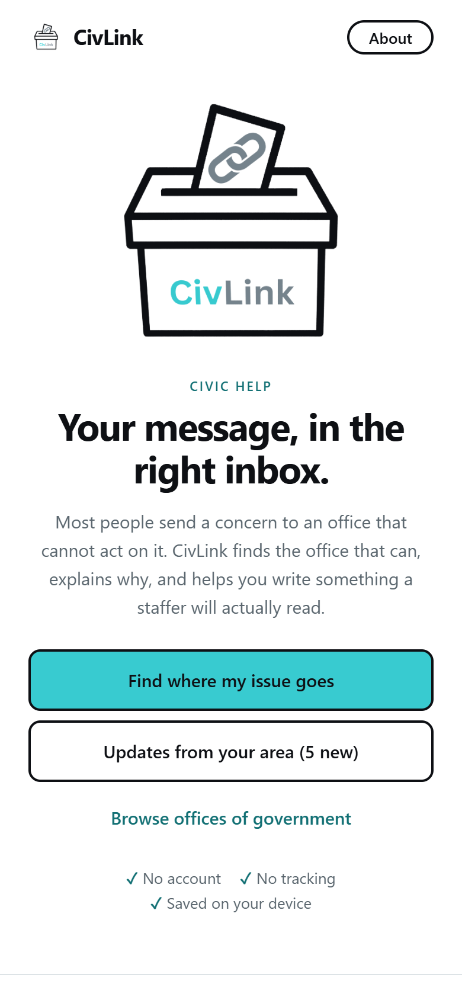 | 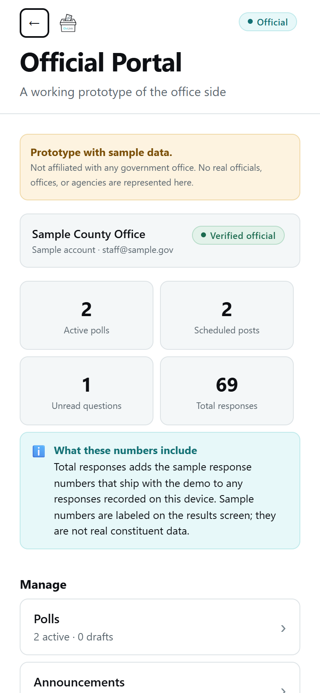 |
| 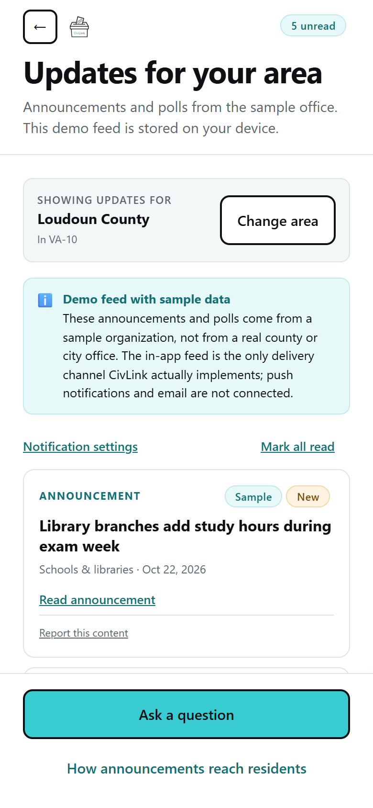 | 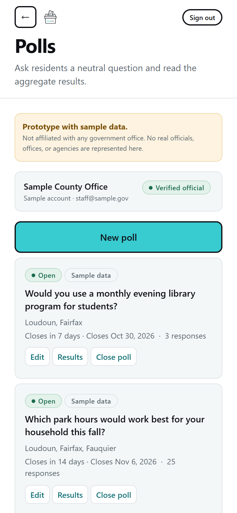 |
| 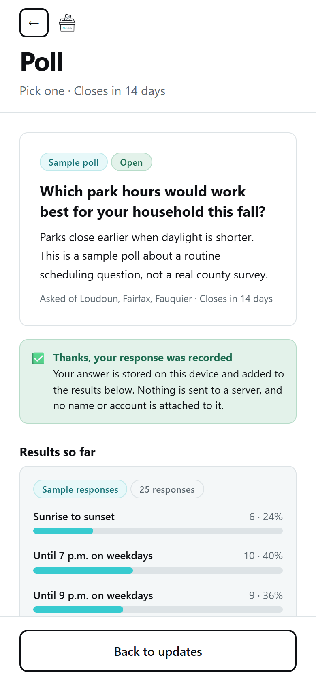 | 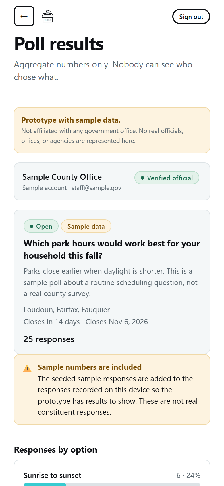 |
| 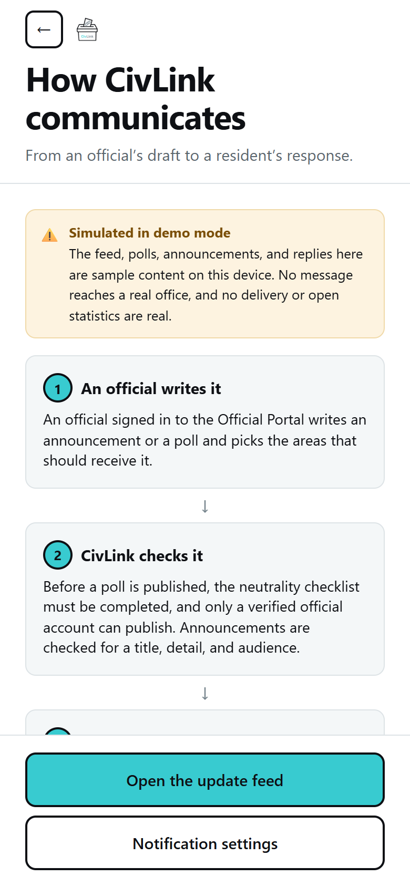 | 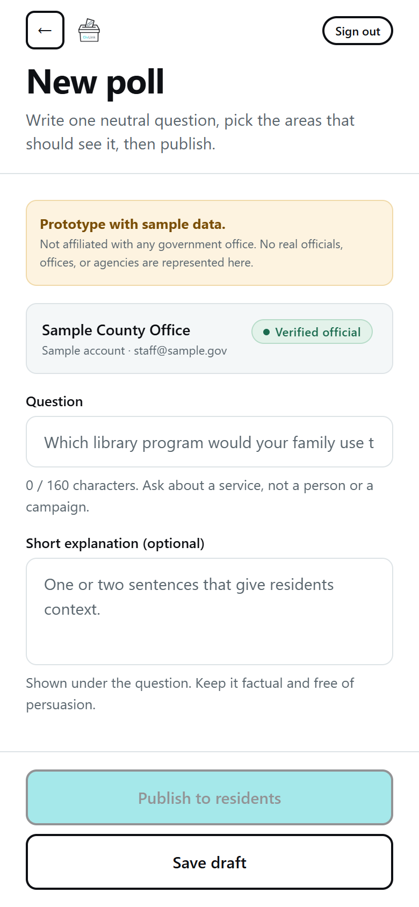 |
| 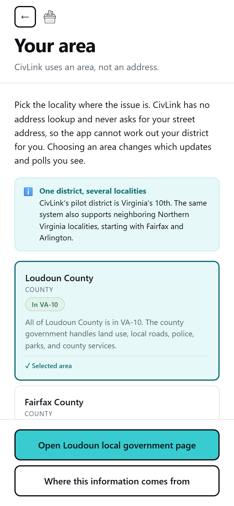 | 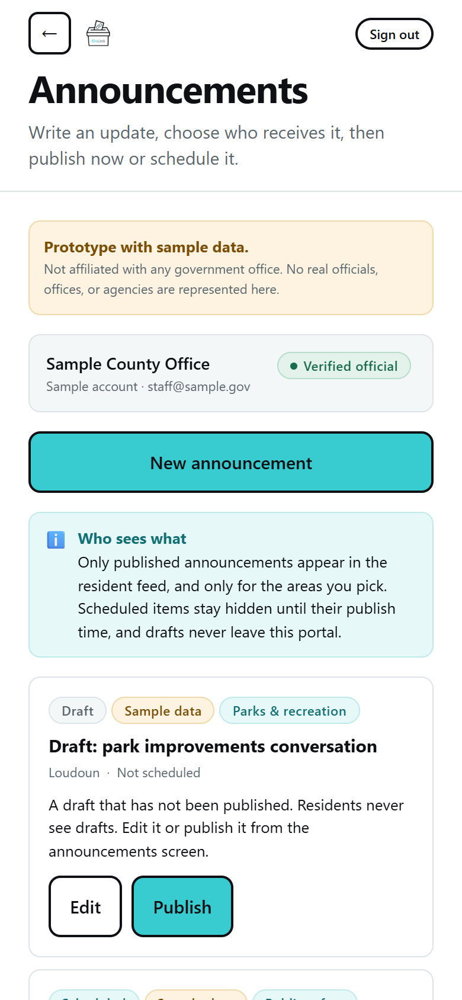 |
| 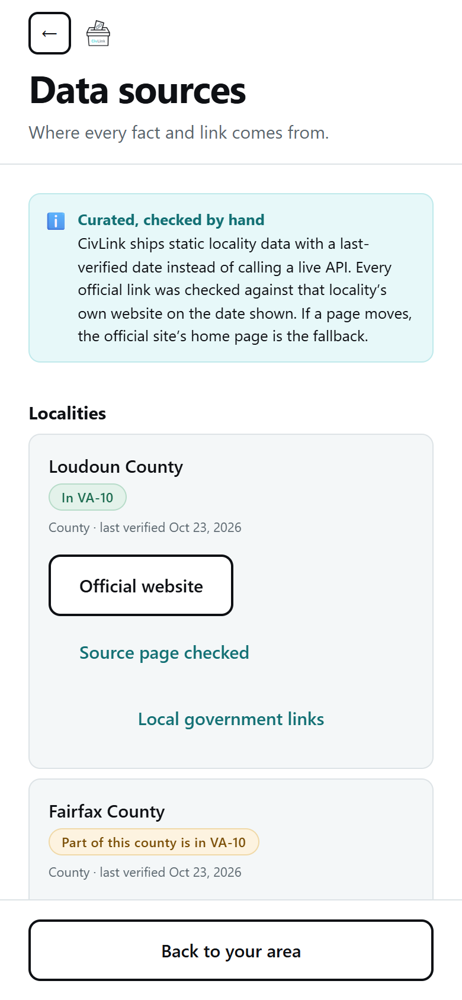 | 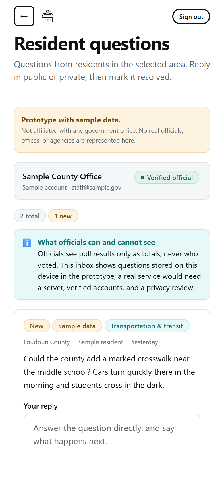 |

More screens: [local government links](submission/screenshots/15-local-government.png),
[content policy](submission/screenshots/22-content-policy.png),
[audit log](submission/screenshots/25-audit-log.png), and
[Get CivLink](submission/screenshots/21-get-civlink.png). The routing, compose, and preview screens
are in `submission/screenshots/02`–`10`.

---

## How communication works

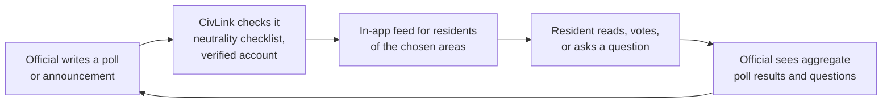

Only the in-app feed is implemented. Push notifications would need a push server and iOS install
rules; an email digest would need an email address, which CivLink never collects. The
[How it works screen](src/screens/HowItWorksScreen.js) states this in the app.

---

## Tech stack

- **React Native 0.86** with **Expo SDK 57** — one codebase for iOS, Android, and web
- **AsyncStorage** for on-device messages and demo civic data
- **expo-clipboard** for copying a saved message, a question reply, or CSV results
- **qrcode-generator** (MIT) for the on-device QR code — nothing is fetched from a QR service
- Plain JavaScript, no state library and no navigation library. `src/navigation/Navigator.js` is a
  small readable stack; `src/context/AppContext.js` holds messages and the draft, and
  `src/context/CivicContext.js` holds the demo portal state.
- Node.js 22 for the test runner (40 tests, no test dependencies)
- A small post-export script adds the PWA manifest, icons, and service worker

---

## Getting started

```bash
npm install
npx expo start        # press w for the web build, or scan with Expo Go
```

```bash
npm test             # 40 unit tests: routing data, validation, polls, CSV, jurisdiction facts
npm run build:web    # static web build in dist/, with PWA manifest and service worker
```

The tests cover the poll rules (one response, closing, sample-data tallies, the five-response
threshold, neutrality gating), CSV escaping, the `.gov` check, rate limiting, and every jurisdiction
fact used in the app.

### Deploy the web version

The build is a static site. On Netlify or Vercel, connect the repository and use:

- build command: `npm run build:web`
- publish directory: `dist`

`netlify.toml` and `vercel.json` are included. Netlify Drop also works: run the build and drag
`dist/` onto the site. Set `EXPO_PUBLIC_WEB_APP_URL` to the final HTTPS address so a phone build
shows the same link and QR code; in a browser, the app reads its own address instead.

The manifest uses `display: standalone`, stable `id`, 192px and 512px icons, and a 180px
`apple-touch-icon`. iPhone: open the link in Safari, Share, then Add to Home Screen. Android: open
the Chrome menu, then Install app. A normal browser tab needs no install.

---

## Project structure

```
├── App.js                       # providers and status bar
├── index.js                     # Expo entry point
├── app.json                     # name, icons, splash
├── assets/branding/             # supplied logo and icons (unmodified)
├── scripts/finalize-web.mjs     # PWA manifest, icons, service worker after export
├── src/
│   ├── components/              # Screen shell, PortalScreen, Button, Field, Badge, CheckRow, QR…
│   ├── context/
│   │   ├── AppContext.js        # draft message + saved messages
│   │   └── CivicContext.js      # area, demo accounts, polls, announcements, questions, votes
│   ├── data/
│   │   ├── offices.js           # 26 offices and the four levels of government
│   │   ├── topics.js            # 13 topics, routing, limits, template
│   │   ├── jurisdictions.js     # 8 localities, official links, VA-10 status, check dates
│   │   ├── seedContent.js       # labeled sample polls, announcements, questions
│   │   └── accounts.js          # sample portal accounts and the .gov format check
│   ├── lib/                     # storage, validation, aggregation, polls, CSV, moderation
│   ├── navigation/Navigator.js  # the screen stack
│   ├── screens/                 # 29 screens: resident, portal, jurisdiction, policy
│   └── theme/index.js           # palette, type scale, radii, spacing
├── tests/                       # node:test files
└── submission/                  # screenshots and written submission pieces
```

---

## Data sources and credits

The sample polls and announcements were written for this prototype and are labeled as sample
wherever they appear. Locality facts and links were checked against the locality's own site on
**2026-10-23**:

| Locality | Official site | Status |
|---|---|---|
| Loudoun County | [loudoun.gov](https://www.loudoun.gov) | In VA-10 |
| Fairfax County | [fairfaxcounty.gov](https://www.fairfaxcounty.gov) | Partly in VA-10 |
| Prince William County | [pwcva.gov](https://www.pwcva.gov) | Partly in VA-10 |
| Fauquier County | [fauquiercounty.gov](https://www.fauquiercounty.gov) | In VA-10 |
| Rappahannock County | [rappahannockcountyva.gov](https://www.rappahannockcountyva.gov) | In VA-10 |
| City of Manassas | [manassasva.gov](https://www.manassasva.gov) | In VA-10 |
| City of Manassas Park | [manassasparkva.gov](https://www.manassasparkva.gov) | In VA-10 |
| Arlington County | [arlingtonva.us](https://www.arlingtonva.us) | In VA-8; expansion area |

- District composition and the redistricting timeline:
  [Virginia's 10th congressional district](https://en.wikipedia.org/wiki/Virginia%27s_10th_congressional_district).
  The app also links the House
  [Find Your Representative](https://www.house.gov/representatives/find-your-representative) lookup
  so an exact address can be checked.
- Google's Civic Information Representatives API was shut down in April 2025, so CivLink does not
  pretend to look officials up live. Locality data is curated and carries a last-verified date.
- Routing explanations for the message tool are based on each office's published responsibilities;
  links are in `src/data/offices.js` and on the About screen.
- Open source: [React](https://react.dev), [React Native](https://reactnative.dev),
  [Expo](https://expo.dev),
  [AsyncStorage](https://react-native-async-storage.github.io/async-storage/),
  [expo-clipboard](https://docs.expo.dev/versions/latest/sdk/clipboard/),
  [qrcode-generator](https://github.com/kazuhikoarase/qrcode-generator) (MIT).
- The CivLink logo, app icons, and favicons were supplied in `assets/branding/` and are used
  unmodified. No third-party images, fonts, or copyrighted music are included.

---

## Privacy

- Resident messages, poll answers, questions, and demo portal data stay on the device. There is no
  server and no account for residents.
- A poll answer records the poll, the chosen options, and the selected locality only — never a name,
  account, or address. Officials see aggregates and turnout by locality, never who voted.
- The Official Portal stores sample accounts on the device. Access requests check only the `.gov`
  email *format*; they prove nothing about identity.
- Any saved message can be deleted, the demo data can be reset from the portal, and the browser or
  device storage can be cleared at any time.
- If device storage is unavailable, the app says so and keeps working for the session.

---

## Honest limitations

- **Prototype, not a service.** No server, no real authentication, and no real official has been
  onboarded. All portal organizations are samples.
- **The in-app feed is the only channel.** Push notifications and email digests are not built, and
  no delivery, open, or read statistics are shown.
- **Sample response counts are labeled.** Seeded polls carry a fixed sample-response block so the
  demo has charts; the results screen says when sample numbers are included. They are not real
  constituent data. A poll hides its results below five responses, and the CSV export is locked
  while results are hidden.
- **No address lookup.** The resident picks an area. CivLink cannot tell which part of Fairfax or
  Prince William County an address is in. Arlington is outside VA-10.
- **Not everything is deep-linked.** Localities with no verified contact or public-comment page
  list only the official pages that were checked.
- **The iOS web install has limits.** It needs Safari and Add to Home Screen; iOS 16.4 or later
  would be required before any future push support could ask for permission. This prototype does
  not send push notifications at all.

---

## AI disclosure

An AI coding assistant wrote and reviewed code at the student's direction. The student chose the
problem, the topics, the design, and the scope, tested the app on a phone and in a browser, and can
explain how each screen works. The dated log of AI-assisted work is in [AI_USAGE.md](AI_USAGE.md).

---

## Submission folder

- [JUDGE_QUICKSTART.md](submission/JUDGE_QUICKSTART.md) — the demo path, demo accounts, reset steps
- [DEMO_VIDEO_SCRIPT.md](submission/DEMO_VIDEO_SCRIPT.md) — a 2–3 minute script
- [SUBMISSION_ANSWERS.md](submission/SUBMISSION_ANSWERS.md) — drafts for the written questions
- `submission/screenshots/` — screenshots of both sides

*Congressional App Challenge 2026 — VA-10. Nonpartisan; no candidate or party is endorsed.*
