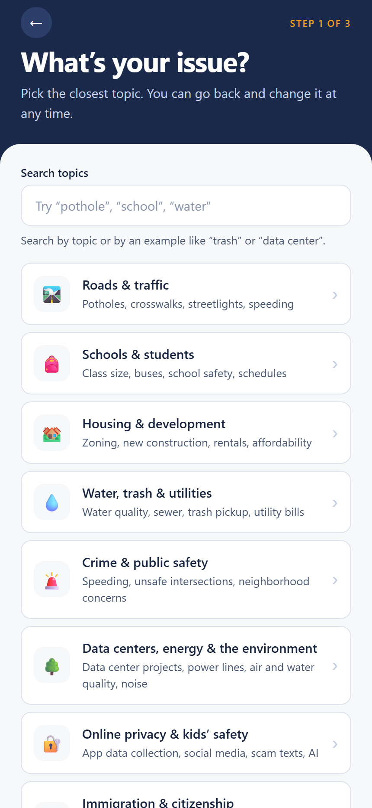
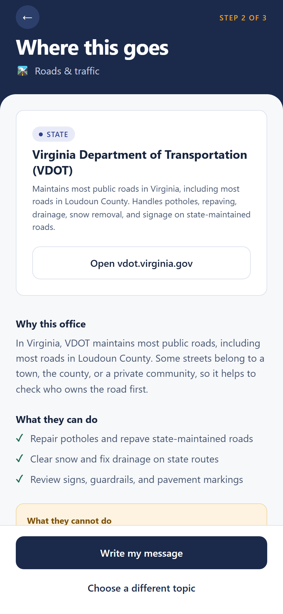
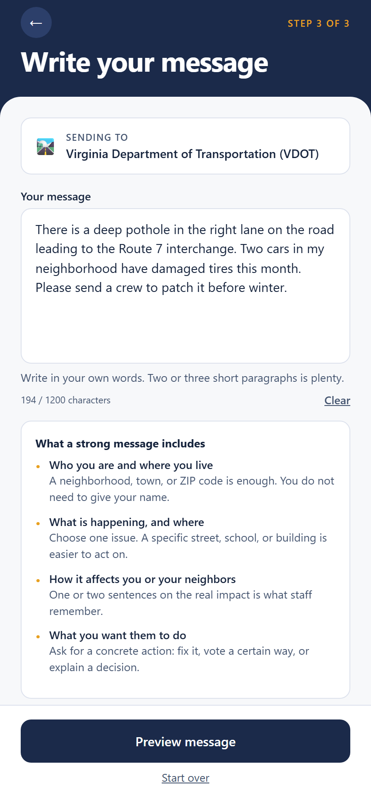
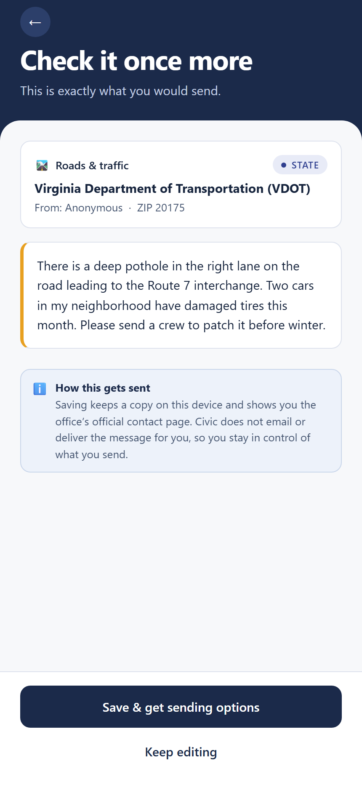
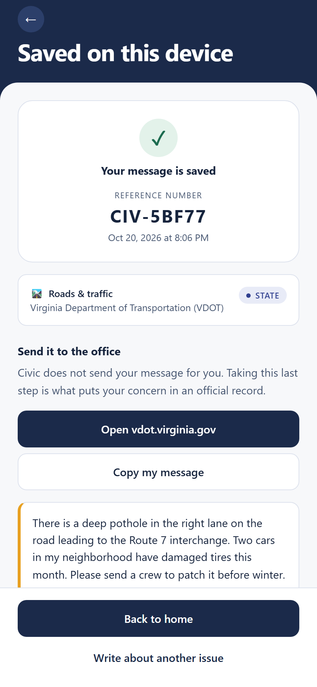
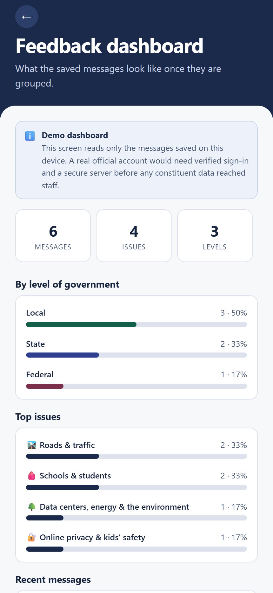
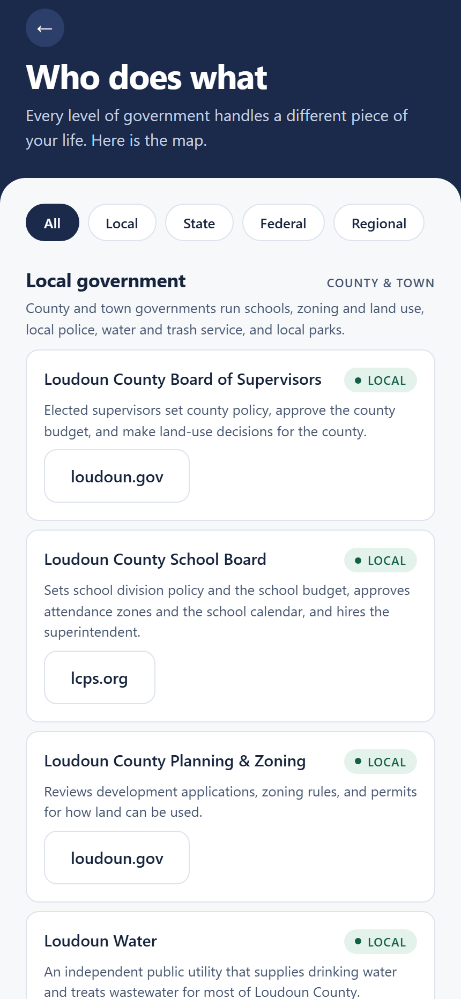

# Civic — find the office that can actually act

A mobile app that helps a Northern Virginia resident figure out which office of government handles
their concern, then write a clear message and send it through that office's own contact page.

Built for the **2026 Congressional App Challenge** — Virginia's 10th District.

---

## What it does

Most people send a concern to an office that cannot act on it, and never hear back. Civic fixes the
routing first:

1. **Pick the issue.** 13 topics, from potholes and school buses to data centers and online privacy.
2. **See who handles it.** Civic names the office with the authority to act, explains why, lists
   what that office can do, and says plainly what it *cannot* do.
3. **Write the message.** A labeled starting template, a length guide, and warnings for unfilled
   `[brackets]`, all-caps text, and links.
4. **Preview and save.** The message is saved on the device with a reference number, and the app
   opens the office's official website so the resident sends it themselves.

A demo dashboard groups saved messages by level of government and by issue, showing what staff
would see if the app were connected to an office.

### Who it is for

Residents of Virginia's 10th District — students, parents, commuters, and neighbors in Loudoun and
the surrounding counties — who have a local problem and no idea whether to call the county, VDOT,
Richmond, or Congress.

### What it deliberately does not do

- No account, no server, no analytics. Messages stay on the device.
- Civic does not email or deliver anything. The resident stays in control of what they send.
- No official sign-in or micro-polls. Those would need a secure backend and verified accounts, which
  is out of scope for this submission.

---

## Screenshots

| | |
|---|---|
|  |  |
|  |  |
|  |  |
|  |  |

The About screen and a small-phone layout are in `submission/screenshots/09-about.png` and
`10-small-screen.png`.

---

## Tech stack

- **React Native 0.81** with **Expo SDK 54** — one codebase for iOS, Android, and web
- **AsyncStorage** for on-device message storage
- **expo-clipboard** for copying a saved message
- Plain JavaScript, no state library and no navigation library. `src/navigation/Navigator.js` is a
  small readable stack, and `src/context/AppContext.js` holds the draft and saved messages.
- Node.js 22 for the test runner

---

## Getting started

```bash
npm install
npx expo start
```

Scan the QR code with the Expo Go app, or press `w` to open the web build.

```bash
npm test      # unit tests for routing data, validation, and aggregation
npm run build:web
```

---

## Project structure

```
├── App.js                     # providers and status bar
├── index.js                   # Expo entry point
├── app.json                   # app name, icon, splash
├── assets/                    # original icon, adaptive icon, favicon
├── scripts/generate-icons.mjs # draws those PNGs from code, no third-party artwork
├── src/
│   ├── components/            # Button, Field, Card, Notice, Screen shell, ...
│   ├── context/AppContext.js  # draft message + saved messages
│   ├── data/offices.js        # 26 offices and the four levels of government
│   ├── data/topics.js         # 13 topics: routing, what they can do, limits, template
│   ├── lib/                   # storage, validation, aggregation, formatting, links
│   ├── navigation/Navigator.js
│   ├── screens/               # Home, Topic, Route, Compose, Preview, Sent, Offices, Dashboard, About
│   └── theme/index.js         # one palette, type scale, and spacing system
├── tests/                     # node:test files
└── submission/                # screenshots and written submission pieces
```

---

## Where the routing information comes from

Each topic's explanation was written from the published responsibilities of the office it routes to,
and every link points at that office's official public site:

- [Loudoun County government](https://www.loudoun.gov) — Board of Supervisors, planning and zoning,
  Commissioner of the Revenue, elections, Sheriff
- [Loudoun County Public Schools](https://www.lcps.org) — School Board and division policy
- [Loudoun Water](https://www.loudounwater.org) — water and sewer service
- [Virginia Department of Transportation](https://www.vdot.virginia.gov) — state-maintained roads
- [Virginia General Assembly](https://virginiageneralassembly.gov) — state law and the budget
- [Virginia DEQ](https://www.deq.virginia.gov) and [State Corporation Commission](https://www.scc.virginia.gov) —
  environmental permits and utility rates
- [Virginia Department of Elections](https://www.elections.virginia.gov), [Department of Health](https://www.vdh.virginia.gov),
  [Department of Education](https://www.doe.virginia.gov), [DMAS](https://www.dmas.virginia.gov),
  [Department of Social Services](https://www.dss.virginia.gov)
- [U.S. House of Representatives](https://www.house.gov/representatives/find-your-representative) and
  [U.S. Senate](https://www.senate.gov/senators/index.htm)
- [Social Security Administration](https://www.ssa.gov), [Medicare](https://www.medicare.gov),
  [USCIS](https://www.uscis.gov), [Veterans Affairs](https://www.va.gov), [USPS](https://www.usps.com)
- [WMATA / Metro](https://www.wmata.com) — regional transit

The app lists offices, not individual officeholders, because names and contact details change often.
Routing explanations are general guidance, not legal advice: an individual address may belong to a
town, an HOA, or a special district instead.

---

## Privacy

- Nothing is sent to a server. There is no account and no analytics.
- Stored on the device only: the topic, the message, a reference number, and a timestamp.
- ZIP code and name are stored only if the writer chooses to add them, and the name is never shown
  to anyone but them.
- Any saved message can be deleted, and the dashboard can clear everything.
- If device storage is unavailable, the app says so and keeps working for the session.

---

## AI disclosure

An AI coding assistant wrote and reviewed code at the student's direction. The student chose the
problem, the topics, and the design, tested the app on a phone and in the browser, and can explain
how each screen works. The dated log of AI-assisted work is in [AI_USAGE.md](AI_USAGE.md).

---

## Credits

- Icons are system emoji. The app icon and splash mark are original, drawn by
  `scripts/generate-icons.mjs`.
- Open source: [React](https://react.dev), [React Native](https://reactnative.dev),
  [Expo](https://expo.dev), [AsyncStorage](https://react-native-async-storage.github.io/async-storage/),
  [expo-clipboard](https://docs.expo.dev/versions/latest/sdk/clipboard/).
- No third-party images, fonts, or copyrighted assets are included.

---

*Congressional App Challenge 2026 — VA-10. Nonpartisan; no candidate or party is endorsed.*
